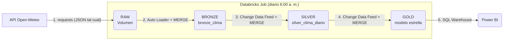
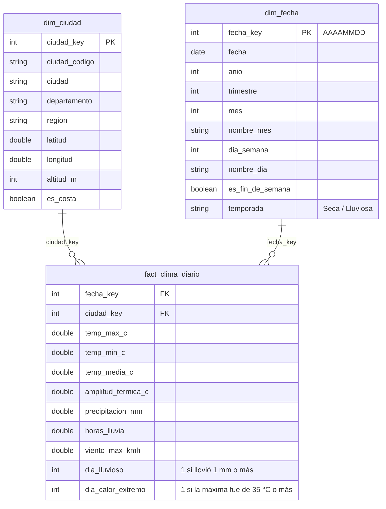

# E_Grupo_5 · Proyecto final: el clima de Colombia en un Lakehouse

Pipeline ELT con **arquitectura medallón** en **Databricks Free Edition**, orquestado con un **Databricks Job**
calendarizado y consumido desde **Power BI**.

# 🌦️ ¿Qué responde este proyecto?

Con el clima diario de 12 ciudades de Colombia:

1. ¿Cuál es la ciudad **más lluviosa**?
2. ¿Cuál es el **mejor mes para viajar a la costa** Caribe? (el que tiene menos días de lluvia)
3. ¿Qué ciudades tienen más días de **calor extremo** (35 °C o más)?
4. ¿Cómo cambia la temperatura mes a mes en cada región?

## Fuente de datos

**[Open-Meteo Historical Weather API](https://open-meteo.com/en/docs/historical-weather-api)**: API pública y gratuita que no pide token.
Para cada ciudad se piden seis variables diarias: temperatura máxima, mínima y media, lluvia (mm), horas de lluvia y viento máximo.

```
GET https://archive-api.open-meteo.com/v1/archive
    ?latitude=4.711&longitude=-74.0721
    &start_date=2025-01-01&end_date=2025-01-31
    &daily=temperature_2m_max,temperature_2m_min,temperature_2m_mean,precipitation_sum,precipitation_hours,wind_speed_10m_max
    &timezone=America/Bogota
```

Ciudades: Bogotá, Medellín, Cali, Barranquilla, Cartagena, Santa Marta, Bucaramanga, Pereira, Cúcuta, Quibdó, Leticia y San Andrés.

## Arquitectura



Todo vive en Unity Catalog: catálogo `workspace`, esquema `proyecto_clima` y volumen `datos`.

## Transformaciones por capa

| Capa | Objeto | Qué se hace |
|---|---|---|
| **Raw** | `/Volumes/workspace/proyecto_clima/datos/raw/clima/` | Se guarda cada respuesta de la API **sin tocarla**: un JSON por ciudad y rango de fechas (`clima_<ciudad>_<desde>_<hasta>.json`). Si el archivo ya existe, no se vuelve a pedir. |
| **Bronze** | `bronze_clima` | **Auto Loader** (`cloudFiles`) detecta los archivos nuevos y los carga a Delta con un **esquema explícito**. Se agregan `source_file` e `ingested_at`, y lo que no encaje en el esquema va a `_rescued_data`. Un archivo es una fila (`MERGE` por `source_file`). Tiene **Change Data Feed** activado. |
| **Silver** | `silver_clima_diario` | Lee de bronze **solo los cambios** con **CDF**, desde la última versión procesada (guardada en `pipeline_state`). Aplana las listas de la API en **una fila por ciudad y día**, convierte la fecha a `DATE`, redondea a un decimal, saca la ciudad del nombre del archivo y descarta los días sin dato y los imposibles (mínima mayor que máxima, lluvia negativa). Si un día llega repetido, gana el más reciente (`MERGE`). Tiene **CDF** activado. |
| **Gold** | `dim_ciudad`, `dim_fecha`, `fact_clima_diario` | **Modelo estrella**. La tabla de hechos lee de silver **solo los cambios** con **CDF**, cambia las llaves naturales por las llaves de las dimensiones y calcula métricas (`MERGE`). |

## Capa Gold: modelo estrella



- **Grano** de la tabla de hechos: una fila por **ciudad y día**.
- `dim_ciudad` sale de una lista de referencia (región, departamento, altitud) y `ciudad_key` es su llave sustituta.
- `dim_fecha` es un calendario generado con `sequence()`. Incluye la **temporada** de Colombia: seca de diciembre a marzo y de junio a agosto, lluviosa de abril a mayo y de septiembre a noviembre.

## Mantenimiento: OPTIMIZE, ZORDER BY y VACUUM

| Tabla | Operación |
|---|---|
| `silver_clima_diario` | `OPTIMIZE ... ZORDER BY (ciudad_codigo, fecha)` |
| `fact_clima_diario` | `OPTIMIZE ... ZORDER BY (ciudad_key, fecha_key)` |
| Todas | `VACUUM ... RETAIN 168 HOURS` (7 días, para no perder el time travel de la semana) |

Se usa Z-Order por ciudad y fecha porque los filtros del reporte son "esta ciudad" y "este periodo".

## Orquestación: Databricks Job

Job `proyecto_clima_colombia`, creado desde el notebook `06_Job_Orquestacion`:

```
ingesta_raw → bronze → silver → gold → mantenimiento
```

| Tarea | Notebook | Detalle |
|---|---|---|
| `ingesta_raw` | `tareas/1_ingesta_raw` | Pide a la API los últimos `dias_atras` días (parámetro, por defecto 5). Tiene 2 reintentos. |
| `bronze` | `tareas/2_bronze` | Auto Loader |
| `silver` | `tareas/3_silver` | CDF y validación: si silver queda vacía, falla y gold no se publica |
| `gold` | `tareas/4_gold` | Dimensiones y hechos |
| `mantenimiento` | `tareas/5_mantenimiento` | OPTIMIZE, ZORDER y VACUUM |

- **Calendario:** todos los días a las **6:00 a. m.** (`0 0 6 * * ?`, zona `America/Bogota`).
- **Alerta:** correo si alguna tarea falla.
- **Bitácora:** cada paso escribe una línea en la tabla `pipeline_log`.

Como cada día se piden los últimos 5 días, los días que se repiten llegan como **actualización** y se ven en el CDF como `update_postimage`. Si la API corrige un dato, el pipeline lo toma solo.

## Power BI

Power BI se conecta al **SQL Warehouse** de Databricks (conector *Azure Databricks*) en modo Import, con las tres tablas de gold.
Las medidas DAX y los visuales están en [`powerbi/GUIA_POWER_BI.md`](powerbi/GUIA_POWER_BI.md).

## Cómo correrlo

1. En Databricks: **Workspace → Create → Git folder** con este repositorio, en la rama `feature/cbolivar`.
2. Abrir `01_Raw_API_a_Volumen` y correrlo con `start_date = 2025-01-01`. Es la carga histórica.
3. Correr `02` → `03` → `04` → `05` en orden. Cada notebook muestra lo que hizo.
4. Correr `06_Job_Orquestacion`: crea el Job calendarizado y lo ejecuta una vez.
5. Conectar Power BI con la guía de `powerbi/`.

## Estructura

```
E_Grupo_5/
├── 00_Setup                    configuración y funciones de cada capa (los demás lo llaman con %run)
├── 01_Raw_API_a_Volumen        API → RAW
├── 02_Bronze_Auto_Loader       RAW → bronze
├── 03_Silver_con_CDF           bronze → silver
├── 04_Gold_Modelo_Estrella     silver → estrella y preguntas de negocio en SQL
├── 05_Mantenimiento            OPTIMIZE / ZORDER / VACUUM
├── 06_Job_Orquestacion         crea y ejecuta el Job
├── tareas/                     un notebook por tarea del Job
└── powerbi/                    guía del reporte
```

## Tecnologías

Databricks Free Edition (serverless), Unity Catalog, Delta Lake (Auto Loader, Change Data Feed, MERGE, OPTIMIZE, ZORDER, VACUUM), PySpark, Databricks Jobs y Power BI.
