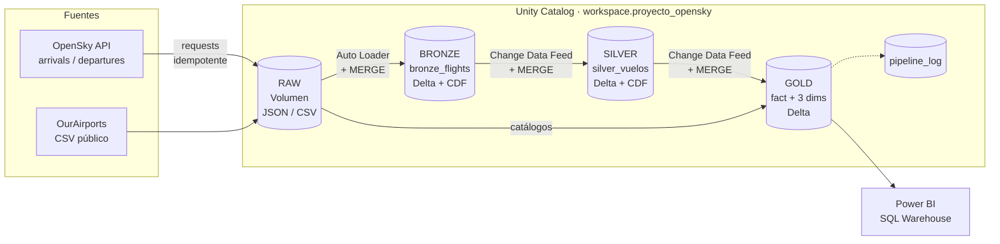
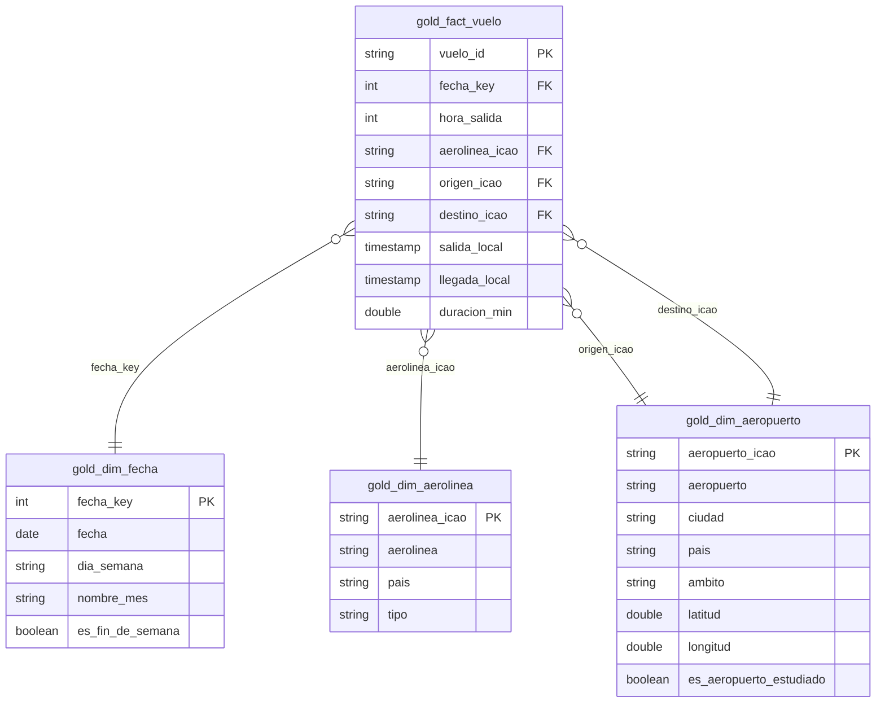
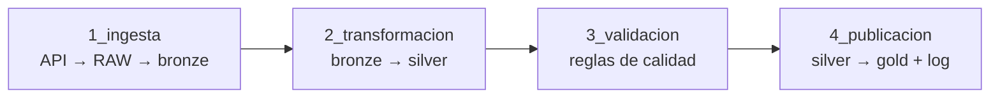

# Tráfico aéreo en Brasil · Pipeline ELT en Databricks

> Proyecto final · Curso Databricks Data Engineer
> **Grupo:** `<nombre del grupo según el Excel>` · **Integrantes:** `<integrante 1>`, `<integrante 2>`

Pipeline ELT de punta a punta que descarga los vuelos reales de los seis aeropuertos con más tráfico de Brasil desde la API pública de **OpenSky Network**, los procesa en una **arquitectura medallón** sobre **Delta Lake** (Auto Loader + Change Data Feed), los modela en un **esquema estrella** y los publica en un reporte de **Power BI**. Todo corre en la **Databricks Free Edition** y se ejecuta solo, todos los días, con un **Job** de cuatro tareas.


---

## Contenido

1. [Preguntas de negocio](#1-preguntas-de-negocio)
2. [Fuentes de datos](#2-fuentes-de-datos)
3. [Arquitectura](#3-arquitectura)
4. [Qué pasa en cada capa](#4-qué-pasa-en-cada-capa)
5. [Modelo estrella (Gold)](#5-modelo-estrella-gold)
6. [Orquestación](#6-orquestación)
7. [Calidad de datos y trazabilidad](#7-calidad-de-datos-y-trazabilidad)
8. [Decisiones y problemas resueltos](#8-decisiones-y-problemas-resueltos)
9. [Estructura del repositorio](#9-estructura-del-repositorio)
10. [Cómo ejecutarlo](#10-cómo-ejecutarlo)
11. [Reporte en Power BI](#11-reporte-en-power-bi)
12. [Limitaciones y siguientes pasos](#12-limitaciones-y-siguientes-pasos)

---

## 1. Preguntas de negocio

El reporte responde cuatro preguntas sobre los aeropuertos de São Paulo (Guarulhos, Congonhas, Viracopos), Río de Janeiro (Galeão, Santos Dumont) y Brasília:

| # | Pregunta | Visual |
|---|---|---|
| 1 | ¿Qué aerolíneas concentran el tráfico? | Barras: participación por aerolínea |
| 2 | ¿Cuánto cae el tráfico el fin de semana? | Columnas: vuelos promedio por día de la semana |
| 3 | ¿A qué hora se concentran las salidas? | Columnas: salidas por hora local |
| 4 | ¿Hacia dónde se vuela desde Brasil? | Mapa: destinos nacionales e internacionales |

---

## 2. Fuentes de datos

| Fuente | Tipo | Qué aporta | Formato en RAW |
|---|---|---|---|
| [OpenSky Network](https://opensky-network.org) · `/api/flights/arrival` y `/api/flights/departure` | **API pública** (OAuth2, cuenta gratuita) | Un registro por vuelo: aeronave (`icao24`), `callsign`, aeropuertos estimados de salida y llegada, hora de despegue y aterrizaje | JSON, uno por aeropuerto × tipo × día |
| [OurAirports](https://ourairports.com/data/) · `airports.csv` y `countries.csv` | **Dataset público** | Nombre, ciudad, país y coordenadas de cada aeropuerto del mundo | CSV |
| Catálogo de aerolíneas | **Archivo plano propio** | Nombre, país y tipo de cada código ICAO de aerolínea que aparece en los datos | CSV |

Aeropuertos consultados (código ICAO): `SBGR`, `SBSP`, `SBGL`, `SBRJ`, `SBBR`, `SBKP`.

---

## 3. Arquitectura



**Por qué esta arquitectura:** cada capa procesa **solo lo nuevo**. Auto Loader recuerda qué archivos ya leyó (checkpoint), y el Change Data Feed le dice a la capa siguiente qué filas cambiaron. Si un día llega un archivo nuevo, se procesa ese archivo; si llega una corrección, se actualiza esa fila; si se borra un vuelo, el borrado se propaga hasta Gold.

---

## 4. Qué pasa en cada capa

| Capa | Objeto | Cómo se carga | Qué se hace |
|---|---|---|---|
| **RAW** | Volumen `raw/flights` y `raw/catalogos` | `requests` contra la API | El JSON se guarda **tal como llega**. La descarga es **idempotente**: si el archivo existe, no se vuelve a pedir. |
| **BRONZE** | `bronze_flights` | **Auto Loader** (`cloudFiles`, `trigger(availableNow=True)`) + `MERGE` en `foreachBatch` | Esquema explícito; lo que no encaja va a `_rescued_data`. Se agregan `source_file` e `ingested_at`. `MERGE` por `(icao24, firstSeen)`: **un vuelo = una fila**, aunque aparezca como salida de un aeropuerto y llegada a otro. |
| **SILVER** | `silver_vuelos` | **Change Data Feed** de bronze + `MERGE` | `vuelo_id` único, horas Unix → `TIMESTAMP` en hora de Brasil, `callsign` limpio, aerolínea extraída del `callsign`, aeropuertos nulos → `DESC`, `duracion_min`. Se excluyen vuelos sin hora de salida y de más de 20 h. |
| **GOLD** | `gold_fact_vuelo` + `gold_dim_*` | **Change Data Feed** de silver + `MERGE` (hechos); dimensiones reconstruidas a partir de silver + catálogos | Esquema estrella listo para BI. |

El avance de cada capa se guarda en la tabla `pipeline_state` (hasta qué versión del origen se procesó), igual que en los laboratorios del curso.

---

## 5. Modelo estrella (Gold)



- **Grano de la tabla de hechos:** un vuelo.
- **`gold_dim_aeropuerto` cumple dos roles** (origen y destino). En Power BI se carga dos veces (`Aeropuerto Origen` y `Aeropuerto Destino`) para que ambas relaciones queden activas.
- **Integridad referencial:** las dimensiones se construyen a partir de **todos** los códigos que aparecen en silver, cruzados con los catálogos. Ninguna clave de la tabla de hechos queda huérfana; lo que no está en el catálogo aparece como *"Sin catálogo"*.

---

## 6. Orquestación

Job de Databricks `proyecto_opensky_brasil`, definido como código en `05_Job_Orquestacion`:



| Capacidad | Configuración |
|---|---|
| Horario | Todos los días a las **08:00 (America/Lima)**. OpenSky procesa los vuelos del día durante la noche. |
| Parámetros | `dias` (ventana de días a revisar, por defecto 3), `start_date`, `aeropuertos`, `min_filas` |
| Reintentos | `ingesta` reintenta 1 vez (la API puede fallar). `validacion` no reintenta: repetir no arregla datos malos. |
| Corte por calidad | Si una regla falla, `publicacion` no corre (`UPSTREAM_FAILED`) y Gold queda intacto. |
| Alertas | Correo al usuario si el Job falla. |
| Log | Cada corrida exitosa agrega una fila a `pipeline_log` con los conteos de cada capa. |
| Cómputo | Serverless (Free Edition), sin clústeres que administrar. |

Con una ventana de 3 días e ingesta idempotente, si un día falla por el límite de la API, la corrida siguiente lo completa sola.

---

## 7. Calidad de datos y trazabilidad

### Reglas de validación (`3_validacion`)

| Regla | Si falla |
|---|---|
| Al menos `min_filas` vuelos | El Job se detiene |
| `vuelo_id` sin nulos ni duplicados | El Job se detiene |
| `fecha` sin nulos | El Job se detiene |
| Duración entre 0 y 20 horas | El Job se detiene |
| Llegada posterior a la salida | El Job se detiene |

### Trazabilidad entre capas (carga del 22 al 29 de octubre de 2026)

Cada registro que desaparece entre capas tiene una razón documentada:

| Etapa | Registros | Motivo |
|---|---:|---|
| Registros en RAW | 16 757 | Un vuelo entre dos aeropuertos estudiados aparece en dos archivos |
| Vuelos únicos en bronze | 15 396 | `MERGE` por `(icao24, firstSeen)`: 1 361 duplicados resueltos |
| − Prueba de borrado (CDF) | −1 | `DELETE` de demostración que viajó por el CDF hasta gold |
| − Sin hora de salida | −10 | Aviación general (matrículas `PP/PR/PS/PT`) que OpenSky vio aterrizar pero no despegar |
| − Duración > 20 h | −27 | Errores de la fuente (dos vuelos unidos o transpondedor encendido en tierra) |
| **Vuelos en silver** | **15 358** | |
| **Vuelos en gold (fact)** | **15 358** | Coincide con silver |

---

## 8. Decisiones y problemas resueltos

| Situación | Decisión |
|---|---|
| OpenSky casi no tiene cobertura de antenas en Perú (los aeropuertos peruanos devolvían 404) | Se hizo un diagnóstico por aeropuerto y se eligió **Brasil**, donde la cobertura es buena y estable. |
| La API devuelve `429` al agotar los créditos diarios | La descarga se **detiene sola**, informa cuántos segundos esperar y conserva lo avanzado. Al ser idempotente, la siguiente corrida retoma donde quedó. |
| Un mismo vuelo llega en dos archivos (salida de A y llegada a B) | `MERGE` por `(icao24, firstSeen)` en bronze. |
| Vuelos con `firstSeen` nulo | Se **conservan en bronze** (es lo que entregó la fuente) y se **excluyen en silver** con regla documentada. El `MERGE` de bronze los identifica por `(icao24, lastSeen)` para no duplicarlos. |
| ~30 % de vuelos sin origen o destino estimado | Es una limitación de la fuente: el aeropuerto consultado siempre se conoce; el otro extremo, solo si una antena lo captó. Se marca `DESC` y se aclara en el reporte. |
| Horas en Unix y UTC | Se convierten a `TIMESTAMP` en `America/Sao_Paulo` en silver. |
| Credenciales de OpenSky | Guardadas en un **secret scope** de Databricks; nunca en el código ni en el repositorio. |

### Gobierno y mantenimiento

- **Unity Catalog** (`07_Unity_Catalog`): nombres de tres niveles, inventario con `information_schema`, comentarios en cada tabla, vista `vw_vuelos_analistas` para el consumo de BI, `GRANT` / `REVOKE` y linaje de punta a punta.
- **Delta Lake** (`06_Time_Travel_y_Mantenimiento`): `DESCRIBE HISTORY`, `VERSION AS OF`, `RESTORE`, `OPTIMIZE ZORDER BY (fecha_key, aerolinea_icao)` sobre la tabla de hechos y `VACUUM` (con la advertencia de por qué no debe usarse con retención baja sobre tablas que alimentan un CDF).

---

## 9. Estructura del repositorio

```
.
├── README.md
├── 00_Setup                       # Configuración y todas las funciones del pipeline
├── 01_RAW_API_a_Volumen           # API OpenSky + OurAirports → Volumen
├── 02_Bronze_Auto_Loader          # RAW → bronze (Auto Loader + MERGE)
├── 03_Silver_con_CDF              # bronze → silver (CDF + MERGE)
├── 04_Gold_Modelo_Estrella        # silver → gold (esquema estrella)
├── 05_Job_Orquestacion            # Definición, ejecución y prueba del Job
├── 06_Time_Travel_y_Mantenimiento
├── 07_Unity_Catalog
├── 08_Pipeline_Completo_y_Cierre  # Pipeline en seis líneas, trazabilidad y requisitos
├── tareas/                        # Un notebook pequeño por tarea del Job
│   ├── 1_ingesta
│   ├── 2_transformacion
│   ├── 3_validacion
│   └── 4_publicacion
└── powerbi/
    ├── reporte_vuelos_brasil.pbix
    └── reporte.png
```

Los notebooks `01` a `04` y `06` a `08` explican y demuestran cada capa paso a paso. El Job no los usa: llama a las funciones del `00_Setup` desde los notebooks de `tareas/`.

---

## 10. Cómo ejecutarlo

### Requisitos

- Cuenta en la **Databricks Free Edition**.
- Cuenta gratuita en **OpenSky Network** con un *API client* (`client_id` y `client_secret`).
- **Power BI Desktop** (Windows).

### Pasos

1. **Clonar el repositorio** en Databricks: *Workspace → Create → Git folder* con la URL de este repositorio.
2. **Guardar las credenciales de OpenSky** en un secret scope (una sola vez, desde un notebook temporal que luego se borra):
   ```python
   from databricks.sdk import WorkspaceClient
   w = WorkspaceClient()
   w.secrets.create_scope(scope="proyecto")
   w.secrets.put_secret(scope="proyecto", key="opensky_client_id",     string_value="<client_id>")
   w.secrets.put_secret(scope="proyecto", key="opensky_client_secret", string_value="<client_secret>")
   ```
3. **Carga inicial:** ejecutar en orden `01` → `02` → `03` → `04`. En `01`, usar `dias = 30` para traer un mes de historia.
4. **Programar el Job:** ejecutar `05_Job_Orquestacion`. Crea el Job, lo corre una vez y lo deja programado a diario.
5. **Power BI:** conectar con el conector *Azure Databricks* usando el *Server hostname* y el *HTTP path* del SQL Warehouse, en modo **Importar**, y cargar las cuatro tablas `gold_*`.

Sin credenciales, `opensky_headers()` usa el acceso anónimo de OpenSky, con un límite de consultas mucho menor.

---

## 11. Reporte en Power BI

- **Modelo:** las cuatro tablas gold, `gold_dim_aeropuerto` cargada dos veces (origen y destino) y `gold_dim_fecha` marcada como tabla de fechas.
- **Medidas DAX principales:** `Vuelos`, `Vuelos por día`, `Duración promedio (min)`, `% Participación`, `Caída fin de semana %`, `% Internacional`.
- **Hallazgos** (22–29 de octubre de 2026):
  - LATAM Brasil, Gol y Azul concentran alrededor del **81 %** de los vuelos detectados.
  - El tráfico baja el fin de semana: Congonhas pasa de ~300 a ~215 llegadas diarias. `<completar con la medida Caída fin de semana %>`
  - Hora pico de salidas: `<completar>`
  - Principales destinos internacionales: `<completar>`

> Los datos son **vuelos detectados por la red de antenas de OpenSky**, no el total oficial de cada aeropuerto.

---

## 12. Limitaciones y siguientes pasos

**Limitaciones**
- La cobertura de OpenSky depende de antenas voluntarias: es una muestra, no un censo.
- Los créditos diarios de la API limitan cuántos días se pueden recuperar de una vez.
- El catálogo de aerolíneas es manual; los códigos nuevos aparecen como *"Sin catálogo"* hasta agregarlos.

**Siguientes pasos**
- Sumar más aeropuertos de Brasil y de la región (por ejemplo, Lima como destino desde los hubs brasileños).
- Agregar el clima de cada aeropuerto (API Open-Meteo) para analizar retrasos y cancelaciones.
- Reemplazar el Job por un pipeline declarativo (Lakeflow / DLT) con expectativas de calidad.
- Publicar el reporte en el servicio de Power BI con actualización programada.
